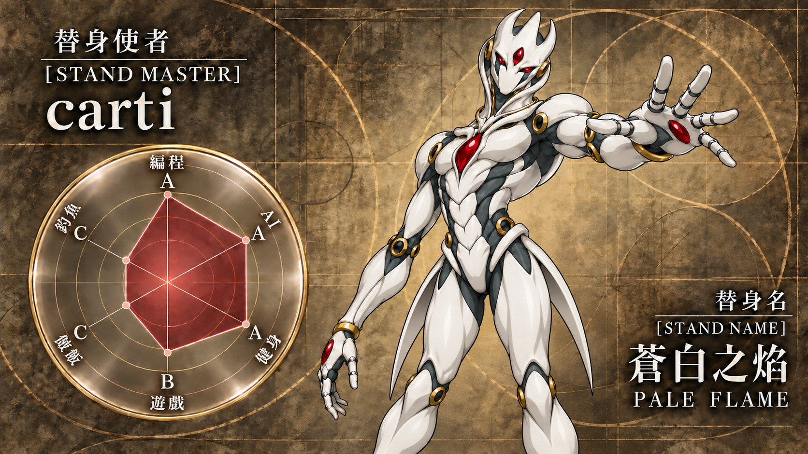

  

  <picture>
    <source media="(prefers-color-scheme: dark)" srcset="./assets/quote-dark.png" />
    
  </picture>

用 Python 和 Java 写代码， 也用 ComfyUI 探索图像创作。

  <picture>
    <source media="(prefers-color-scheme: dark)" srcset="./assets/divider-dark.svg" />
    
  </picture>

<h3 align="center">技术栈</h3>

  

Python · Java · Linux · MySQL

  

VS Code · PyCharm · Postman · Git · GitHub · ComfyUI

  <picture>
    <source media="(prefers-color-scheme: dark)" srcset="./assets/divider-dark.svg" />
    
  </picture>

  <picture>
    <source media="(prefers-color-scheme: dark)" srcset="./assets/wechat-dark.svg" />
    
  </picture>&nbsp; <samp>zsq1282215580</samp>

  <a href="mailto:1282215580@qq.com">
    <picture>
      <source media="(prefers-color-scheme: dark)" srcset="./assets/mail-dark.svg" />
      
    </picture>&nbsp; <samp>1282215580@qq.com</samp>
  </a>

  <picture>
    <source media="(prefers-color-scheme: dark)" srcset="./assets/to-be-continued-dark.png" />
    
  </picture>

